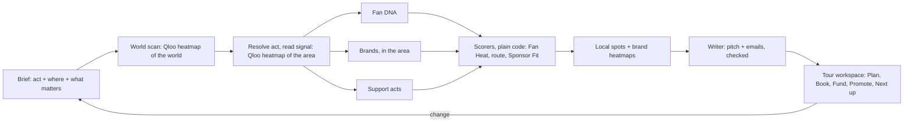

<h1 align="center">
  <picture>
    <source media="(prefers-color-scheme: dark)" srcset="public/brand/afinlo-logo-dark.png">
    
  </picture>
</h1>

<p align="center"><b>Find your real fans. Get paid to reach them.</b></p>

Afinlo is an AI tour manager that knows your fans. Tell it which artist or comedian is touring and where, anywhere in the world. It plans the tour from Qloo's taste data, finds the venues and the sponsors, drafts the emails, and keeps track of every follow-up. Qloo supplies every city, venue, brand and act; plain code scores them; a language model, when one is connected, only writes.

- **Live demo:** _add the public URL here when it's deployed_ · no sign-up
- **Try first:** the example tours on Home: *Khruangbin* in Europe, *Bad Bunny* in Latin America, *Wegz* in the Middle East and North Africa, *Morgan Wallen* and *Taylor Tomlinson* in North America, *Glass Beams* in Australia and the Pacific. Then plan one for an act you know.
- Built for the [Qloo Agentic Hackathon](https://qloo.devpost.com) · Apache 2.0

## The problem

Independent musicians and comedians pick tour cities by instinct and pitch the same famous brands as everyone else. Ask a general chatbot and it tends to suggest the biggest cities and the best-known brands, because it has no data on where a particular act's audience actually is. Afinlo uses Qloo's taste data to find the cities where *this* act's fans over-index, the venues and brands *these* fans love, and turns that into a tour a manager can book, fund and promote.

## What it does

1. **The brief.** Find the act in Qloo. Afinlo looks at where its fans are across the whole world (one Qloo heatmap) and shows it on a map, with the regions and countries ranked. Pick a region or countries, then say what matters: how many shows, big cities or hidden markets first, where the tour starts, which sponsor categories to pitch and which never to.
2. **The tour,** as a workspace: the plan on the left in five tabs, a real map on the right (Qloo's heatmap as a heat layer, the route with drives and flights, numbered stops).
   - **Plan:** the route stop by stop, each with its Fan Heat and how it's reached (a drive up to 650 km, a flight beyond); no two stops within 150 km, as a promoter's radius clause would have it; the strong cities not on the route; quick changes (shorter, longer, hidden markets first, one sponsor category, skip a city).
   - **Book:** in each city, the music venues or comedy clubs these fans love, pinned on the map, each with a drafted hold request and where it stands (to contact, asked, on hold, confirmed, passed).
   - **Fund:** the brands these fans love, ranked by Sponsor Fit, each with its evidence, a drafted pitch and where it stands (to send, sent, replied, signed, passed); the five-page PDF deck.
   - **Promote:** who the fans are (taste, age and gender skew), the podcasts, shows, books and films they love, openers whose fans overlap, and in each city the local businesses to partner with and the places fans go.
   - **Next up:** what to do now, in order: a venue for every stop, a pitch for the best sponsors, a follow-up when a pitch has had no answer for five days, a reply when it has.
3. **It remembers.** Each act's choices (where it tours, how long) and every no (a sponsor category, a brand, a city) carry into its next tour. **Home** shows every tour and what needs doing across them; **Acts** shows each act and what Afinlo remembers about it.

Nothing needs an account: tours, statuses and what's remembered are kept per browser. When Qloo has no location data for an act, the plan is estimated from acts with overlapping audiences and labelled so; when there's nothing to go on, it says so instead of guessing.

## How Qloo is used

| Step | Qloo request | Used for |
| --- | --- | --- |
| Resolve the act | `GET /search` (artists, then people) | The act's entity; the user confirms the exact one |
| Where in the world | `GET /v2/insights` with `urn:heatmap`, `filter.location` = the world | About 3,000 cells of 150 km: the countries and regions where the fans are |
| Fan Heat | `GET /v2/insights` with `urn:heatmap`, `filter.location` = the region, or boxes around the chosen countries | Thousands of cells, from 5 km in one country to 40 km across a region |
| Fan DNA | `GET /v2/insights` with `urn:tag`, `urn:demographics`, and film/TV/podcast/book types | Taste, aggregate demographics, cross-domain loves |
| Sponsor match | `GET /v2/insights` with `urn:entity:brand` and `signal.location` = the tour's area, one call per category tag | Brands this audience loves there, and their affinity |
| Sponsor evidence | `GET /v2/insights` heatmap for each top brand, in the tour's area | Where the brand's audience is strongest on the route |
| Support acts | `GET /v2/insights` with `urn:entity:artist`; `GET /v2/insights/compare` | Openers with overlapping audiences, and shared taste |
| Venues and partners | `GET /v2/insights` with `urn:entity:place` and `filter.location=POINT(…)` near each stop, by venue, bar, brewery, restaurant and clothing-store tags | Venues (falling back to live-music and event venues where Qloo tags few), local partners, places fans love |

Pictures of acts, brands and places are Qloo's own (`images.qloo.com`), resized by this server. A tour takes 20–30 Qloo requests, plus 6–8 for each stop opened in Book or Promote. Responses are cached for 24 hours and identical requests within a day reuse the plan. Every tour lists its requests under **Receipts**.

## Architecture



- The agent is a LangGraph graph (`src/platform/tour/agent.ts`); Fan DNA, brands and support acts run in parallel, at most four Qloo requests in flight.
- Scoring is plain TypeScript (`src/core/tour/scoring.ts`): the same Qloo answers always give the same plan. Next up is plain rules too (`next.ts`).
- The candidate cities are the world's: 2,737 cities of 90,000 people or more in 184 countries, one per metro, from Natural Earth (public domain; `world.json`, built by `scripts/world-cities.mts`). Countries are grouped into 11 touring regions (`regions.ts`). An area is asked of Qloo as one shape: a region's box, or boxes around the chosen countries' cities, merged where they touch (`world.ts`).
- The map is MapLibre GL with OpenFreeMap's vector tiles, fetched through this server (`/map-tiles`, a Next.js rewrite), so the content policy stays same-origin. The landing page, the info pages and the PDF deck draw a still map on the server instead (`StaticMap.tsx`, Natural Earth land from world-atlas).
- The writer (`writer.ts`) sees only scored results with their IDs. A draft that names a city or brand outside the plan, or states a money figure or percentage, is replaced by a plain template, and the plan says so. Without a language model, the pitch, the hold requests and the follow-ups are plain templates drafted from the plan's facts.
- Plans never change: a change makes a new plan, and the tour keeps its first plan's ID, so where each venue and sponsor stands carries over (`tracker.ts`). Tours, statuses and what's remembered about acts are kept per browser, by a visitor cookie (`saved.ts`, `tracker.ts`).
- Each stage streams to the page as it starts. Per-visitor and daily limits protect the Qloo quota.
- The PDF deck is the `/deck/[id]` page printed by a headless Chrome or Edge on the server (`pdf.ts`), once per plan.

Full details, including every scoring rule: the app's [How it works](src/app/(site)/how-it-works/page.tsx) page.

## Run it locally

Requirements: Node.js 24+, PostgreSQL 15+, a Qloo hackathon API key, Chrome or Edge for PDF decks (found in the usual install places, or set `PDF_BROWSER`), and internet access for the map tiles. A language model is optional: with `OPENAI_API_KEY` set, the AI writer drafts the pitch and a typed change ("swap Denver for somewhere near Seattle") becomes new filters; without it, everything else works and drafts are templates.

```sh
npm ci
cp .env.example .env.local
# In .env.local: QLOO_API_KEY, and DATABASE_URL for an empty Postgres database (OPENAI_API_KEY optional)
npm run examples   # builds the one-click example tours
npm run dev        # http://localhost:3001
```

The tables are made on first use. Keys stay on the server: never in the browser, URLs, plans or logs.

## Checks

```sh
npm run typecheck
npm run lint
npm test           # scoring, regions and areas, Next up, the agent, brand matches, pairings and city guides against fixture Qloo; tours and statuses kept per browser
npm run build
```

`npm test` proves behavior (grounding, fallbacks, failures, the writer's checks, routing rules, what each browser can see), not the quality of Qloo's data.

## Does it work?

The app's **Does it work?** page reports what's measured, and nothing that isn't:

- **Without Qloo there is no tour.** Every result carries a Qloo ID; failures show as failures.
- **Specificity:** how much different acts' routes overlap, measured live from the example tours.
- **Backtest** against public listener-city data, compared with what a booker without taste data would play, the biggest cities ([method](docs/evaluation/backtest.json), `npm run backtest`): pending. The listener data has to be recorded by hand.

Limits: Fan Heat is taste affinity, not ticket demand. A sponsor match means a brand's customers love the act, not that it will sponsor; Qloo's brand results are mostly global brands, and its location signal leans them toward the tour's area. Qloo tags few venues in some cities (Berlin, Cairo), so Afinlo falls back to live-music and event venues there, and says so when there are none. Some acts have little Qloo data. Demographics are aggregate; Afinlo uses no personal data and sends nothing on anyone's behalf.

## Other tools on the same data

Two earlier tools are still in the codebase, outside the main navigation: **For brands** (`/brands`: the acts whose fans love a brand, and where both audiences meet) and **Co-headliners** (`/co-headline`: two acts' shared cities and a double-bill route). Both cover the United States.

## Photos

The landing page's photos are in `public/images/photos/`, listed with their alt text, where each appears, and their credits in `src/components/tour/photos.ts`. Today they're free Unsplash photos (Unsplash License). To use your own, replace the files (same names) with photos you have the rights to show, and update the alt text to describe them.

## Credits

Afinlo is independent and isn't a Qloo product. Map data © OpenStreetMap contributors, tiles by OpenFreeMap; city data from Natural Earth.

Apache 2.0: see [LICENSE](LICENSE) and [NOTICE](NOTICE).
