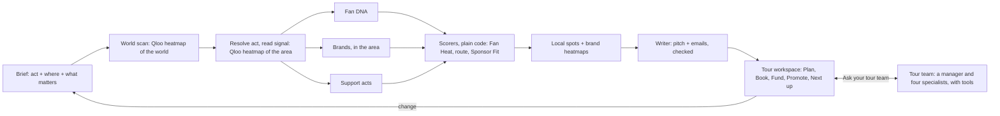
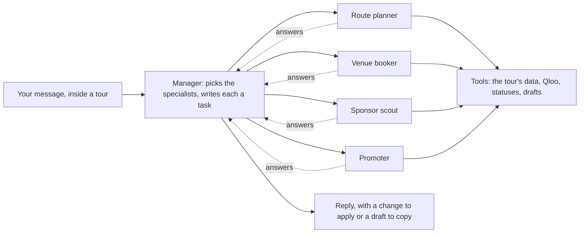

<h1 align="center">
  <picture>
    <source media="(prefers-color-scheme: dark)" srcset="public/brand/afinlo-logo-dark.png">
    
  </picture>
</h1>

<p align="center"><b>Find your real fans. Get paid to reach them.</b></p>

Afinlo is an AI tour manager that knows your fans. Tell it which artist or comedian is touring and where, anywhere in the world. It plans the tour from Qloo's taste data, finds the venues and the sponsors, drafts the emails, and keeps track of every follow-up. Inside each tour, a team of AI agents answers questions about it, proposes changes and drafts the outreach. Qloo supplies every city, venue, brand and act, and plain code scores them and plans the route. The agents explain, propose and write from those results only.

- **Live demo:** _add the public URL here when it's deployed_ · no sign-up
- **Try first:** the example tours on Home: *Khruangbin* in Europe, *Bad Bunny* in Latin America, *Wegz* in the Middle East and North Africa, *Morgan Wallen* and *Taylor Tomlinson* in North America, *Glass Beams* in Australia and the Pacific. Then plan one for an act you know.
- Built for the [Qloo Agentic Hackathon](https://qloo.devpost.com) · Apache 2.0

## The problem

Independent musicians and comedians pick tour cities by instinct and pitch the same famous brands as everyone else. Ask a general chatbot and it tends to suggest the biggest cities and the best-known brands, because it has no data on where a particular act's audience actually is. Afinlo uses Qloo's taste data to find the cities where *this* act's fans over-index, the venues and brands *these* fans love, and turns that into a tour a manager can book, fund and promote.

## What it does

1. **The brief.** Find the act in Qloo. Afinlo looks at where its fans are across the whole world (one Qloo heatmap) and shows it on a map, with the regions and countries ranked. Pick the whole world, a region or countries, then say what matters: how many shows, big cities or hidden markets first, where the tour starts, which sponsor categories to pitch and which never to. For an act Qloo doesn't know yet, name two or three acts it's like: the tour is planned from their fans, and labelled predicted.
2. **The tour,** as a workspace: the plan on the left in five tabs, a real map on the right (Qloo's heatmap as a heat layer, the route with drives and flights, numbered stops).
   - **Plan:** why this route, then the route stop by stop.
     - **Why this route:** the route's average Fan Heat next to that of the area's biggest cities, the tour a booker with no taste data would play. Morgan Wallen's North America tour scores 93 against 47.
     - Each stop shows its Fan Heat and how it's reached: a drive up to 650 km, a flight beyond. Each can be skipped.
     - Every tour plays the act's hottest market.
     - No two stops are within 150 km, as a promoter's radius clause would have it.
     - A world tour keeps shows 400 km apart and gives no country more than a quarter of them.
     - Any other change (more or fewer shows, a city added, hidden markets first, another area) is asked of the tour team.
   - **Book:** in each city, the music venues or comedy clubs these fans love, pinned on the map, each with a drafted hold request and where it stands (to contact, asked, on hold, confirmed, passed).
   - **Fund:** the brands these fans love, ranked by Sponsor Fit, each with its evidence, a drafted pitch and where it stands (to send, sent, replied, signed, passed); the five-page PDF deck.
   - **Promote:** who the fans are (taste, age and gender skew), the podcasts, shows, books and films they love, openers whose fans overlap, and in each city the local businesses to partner with and the places fans go.
   - **Next up:** what to do now, in order: a venue for every stop, a pitch for the best sponsors, a follow-up when a pitch has had no answer for five days, a reply when it has.
3. **Your tour team.** A message bar at the foot of every tab opens into a conversation inside the tour (on a phone, a sheet along the bottom). A manager agent hands each message to the specialists it needs: a route planner, a venue booker, a sponsor scout and a promoter. It replies from what they found. Ask why a city is on the route, ask for a change you apply in one click ("make it 8 shows"), or ask for a pitch in Spanish or posts for a city. See [The tour team](#the-tour-team).
4. **It remembers.** Each act's choices (where it tours, how long) and every no (a sponsor category, a brand, a city) carry into its next tour. **Home** shows every tour and what needs doing across them; **Acts** shows each act and what Afinlo remembers about it.

Nothing needs an account: tours, statuses and what's remembered are kept per browser. When Qloo has no location data for an act, the plan is estimated from acts with overlapping audiences and labelled so; when there's nothing to go on, it says so instead of guessing.

## How Qloo is used

| Step | Qloo request | Used for |
| --- | --- | --- |
| Resolve the act | `GET /search` (artists, then people) | The act's entity; the user confirms the exact one |
| Where in the world | `GET /v2/insights` with `urn:heatmap`, `filter.location` = the world | About 3,000 cells of 150 km: the countries and regions where the fans are |
| Fan Heat | `GET /v2/insights` with `urn:heatmap`, `filter.location` = the region, boxes around the chosen countries, or the world for a world tour | Thousands of cells, from 5 km in one country to 40 km across a region and 150 km across the world |
| An act Qloo doesn't know | Every request below, with the two or three acts named as like it as the signal | The tour, predicted from their fans and labelled so |
| Fan DNA | `GET /v2/insights` with `urn:tag`, `urn:demographics`, and film/TV/podcast/book types | Taste, aggregate demographics, cross-domain loves |
| Sponsor match | `GET /v2/insights` with `urn:entity:brand` and `signal.location` = the tour's area, one call per category tag | Brands this audience loves there, and their affinity |
| Sponsor evidence | `GET /v2/insights` heatmap for each top brand, in the tour's area | Where the brand's audience is strongest on the route |
| Support acts | `GET /v2/insights` with `urn:entity:artist`; `GET /v2/insights/compare` | Openers with overlapping audiences, and shared taste |
| Venues and partners | `GET /v2/insights` with `urn:entity:place` and `filter.location=POINT(…)` near each stop, by venue, bar, brewery, restaurant and clothing-store tags | Venues (falling back to live-music and event venues where Qloo tags few), local partners, places fans love |
| The tour team | The same requests, through the agents' tools: more brands in a category, a brand's heatmap along the route, a stop's venues and places | Answers and drafts from Qloo's results, never from the model's memory |

Pictures of acts, brands and places are Qloo's own (`images.qloo.com`), resized by this server. A tour takes 20–30 Qloo requests, plus 6–8 for each stop opened in Book or Promote. Responses are cached for 24 hours and identical requests within a day reuse the plan. Every tour lists its requests under **Receipts**.

## Architecture



- The planning agent is a LangGraph graph (`src/platform/tour/agent.ts`); Fan DNA, brands and support acts run in parallel, at most four Qloo requests in flight.
- Scoring is plain TypeScript (`src/core/tour/scoring.ts`): the same Qloo answers always give the same plan. Next up is plain rules too (`next.ts`), and so is why a city is or isn't on the route (`why.ts`), which the route planner agent explains rather than guesses.
- The candidate cities are the world's: 2,737 cities of 90,000 people or more in 184 countries, one per metro, from Natural Earth (public domain; `world.json`, built by `scripts/world-cities.mts`). Countries are grouped into 11 touring regions (`regions.ts`). An area is asked of Qloo as one shape: a region's box, boxes around the chosen countries' cities merged where they touch, or the whole world (`world.ts`).
- A world tour reads Qloo's coarse world cells, about 150 km across, its own way, so one odd cell can't make a city hot:
  - A city counts only its own country's cells.
  - It leans on its country's average.
  - Its market size is what its people can spend: its population times its country's GDP per head (Natural Earth; `spending.json`, built by `scripts/world-spending.mts`).
- The heat layer is calibrated to Qloo's grid (`heat.ts`): an even field draws its own value at every zoom and latitude, and the scale is anchored to the act's hottest 5% of places.
- An act Qloo doesn't know gets a stable ID from its name (`named.ts`), and every Qloo request takes the acts named as like it as the signal.
- The map is MapLibre GL with OpenFreeMap's vector tiles, fetched through this server (`/map-tiles`, a Next.js rewrite), so the content policy stays same-origin. The landing page, the info pages and the PDF deck draw a still map on the server instead (`StaticMap.tsx`, Natural Earth land from world-atlas). The hero's background is a WebGL shader of moving contour lines with a blue scan (`HeroLines.tsx`). How it works' maps are the same live map, moving on their own in a loop (`MapLoop.tsx`). That section follows one example tour with looping pieces of the interface, tied to the scroll by GSAP's ScrollTrigger, with Lenis for smooth scrolling (`HowOnScroll.tsx`).
- The writer (`writer.ts`) sees only scored results with their IDs. A draft that names a city or brand outside the plan, or states a money figure or percentage, is replaced by a plain template, and the plan says so. Without a language model, the pitch, the hold requests and the follow-ups are plain templates drafted from the plan's facts, and the tour team says it needs a key.
- Plans never change: a change makes a new plan, and the tour keeps its first plan's ID, so where each venue and sponsor stands carries over (`tracker.ts`). Tours, statuses and what's remembered about acts are kept per browser, by a visitor cookie (`saved.ts`, `tracker.ts`).
- Each stage streams to the page as it starts. Per-visitor and daily limits protect the Qloo quota.
- The PDF deck is the `/deck/[id]` page printed by a headless Chrome or Edge on the server (`pdf.ts`), once per plan.

Full details, including every scoring rule: the app's [How it works](src/app/(site)/how-it-works/page.tsx) page.

## The tour team

The multi-agent part of Afinlo, in `src/platform/manager`. You talk to it inside a tour, and it works only through tools over that tour's data and Qloo.



| Agent | Answers | Can do | Its tools |
| --- | --- | --- | --- |
| Manager | Which specialists a message needs (their answers are the reply), using what's on your screen | Remembers each "no" about the act for its next tours; opens a tab or stop for you | A hand-off to each specialist, `act_memory`, `remember_no`, `show_on_page` |
| Route planner | Why a city is or isn't on the route, distances, drives and flights, hidden markets, the comparison with the biggest cities | Proposes a change: the number of shows, cities skipped or added, the start, the area (the whole world included), hidden markets first | `route_overview`, `city_details`, `cities_off_route`, `propose_change` |
| Venue booker | The venues these fans love at each stop, and where each stands | Sets a venue's status; drafts a hold request | `route_overview`, `stop_venues`, `set_venue_status`, `save_draft` |
| Sponsor scout | The sponsors, their fit and their evidence | Finds more brands in a category; sets a sponsor's status; drafts a pitch in any language | `route_overview`, `sponsor_list`, `more_brands`, `brand_strength`, `set_sponsor_status`, `save_draft` |
| Promoter | Who the fans are, what else they love, openers | Drafts posts for a city: the promo pack | `route_overview`, `fan_dna`, `city_spots`, `save_draft` |

- **Supervisor pattern, in LangGraph.** The manager hands work out through one tool per specialist, and calls to several fan out in parallel (`Send`). Each specialist is its own small graph (`StateGraph` and `ToolNode`): a loop of thinking and looking things up, with its own prompt, tools and model. It sees only its task, so every context stays short.
- **Grounded.** The agents see the tour and Qloo only through tools with zod schemas, and every city, brand and venue they name comes from a tool's answer. There's no vector index: the data is structured, with IDs, so the tools look things up exactly. Tool answers, Qloo's text and your words reach the model as fenced data, never as instructions.
- **You decide.** A change is a proposal until you click Apply, and once applied it can be undone. The planning agent then makes a new version of the tour from Qloo's data, and statuses carry over. Anything it can't plan around yet (no flights, dates) is shown as not applied.
- **Checked.** Drafts, the pitch and every final reply pass one check for claims the data can't support: money, audience or sales counts, anyone having agreed (`src/core/tour/claims.ts`), and no names outside the tour.
- **Kept.** Brands the team finds and drafts it writes are kept with the tour, listed in Fund to reopen, however long the conversation gets.
- **Memory.** Each tour's conversation is kept per browser in LangGraph's Postgres checkpointer, and survives a reload and every change to the tour. Each model call reads only the last few messages, as what was said, never old tool results; after five turns the older ones fold into a running summary. A turn cut short is repaired before the next one.
- **Limits.**
  - Per message: at most four specialist answers in three rounds, four steps per specialist (the last can't call tools), ten lookups across the team, and 60 seconds. A tool's error comes back to the agent as text, so it can recover.
  - Each visitor can send 30 messages an hour, and the server answers 600 a day (`HOURLY_CHAT`, `DAILY_CHAT`), counted in the database.
- **Models.** Every model call Afinlo makes is in one table, `MODELS` in `src/platform/tour/model.ts`.
  - All of them are GPT-6 Luna, on OpenAI's Responses API through LangChain.
  - Each gets the least reasoning its job needs, since reasoning is billed as output: none for the manager and the summarizer; low for the assistant, route planner, venue booker, promoter, sponsor scout and pitch writer, whose text is checked in code for claims the data can't support.
  - Nothing is stored at OpenAI, and each role has its own prompt cache key.
  - Every request logs its calls, tokens and cost by role, and keeps them in `tour_model_usage`. Tool answers reach the models as compact text, thanks and hellos need no model, and a specialist's answer is the reply without a second manager call.
- **Streamed.** The chat route (`/api/tour/plan/[id]/chat`) streams each step to the page as it happens, then the reply. The steps are who was asked, each lookup and each answer.
- **Tested.**
  - Thirteen tests run the team against scripted models and fixture Qloo. They cover routing, a specialist seeing only its task, two at once, proposals and compound changes, checked drafts and replies, statuses and "no"s, the limits, the memory and its summary, a turn cut short, a failed reply after a save, kept brands and drafts, and what's on screen.
  - `npm run eval` sends 21 messages across three example tours to the live model. It checks each reply and draft for the right specialist, no made-up city anywhere in the world, no unsupported claim, and the change or draft asked for, in the language asked (read from its text). Any failure, or a missing case, fails the command.

## Run it locally

Requirements: Node.js 24+, PostgreSQL 15+, a Qloo hackathon API key, Chrome or Edge for PDF decks (found in the usual install places, or set `PDF_BROWSER`), and internet access for the map tiles. A language model is optional. With `OPENAI_API_KEY` set, the AI writer drafts the pitch and the tour team answers. Without it, everything else works, drafts are templates, and the tour team says it needs a key.

```sh
npm ci
cp .env.example .env.local
# In .env.local: QLOO_API_KEY, and DATABASE_URL for an empty Postgres database (OPENAI_API_KEY optional)
npm run examples   # builds the one-click example tours
npm run dev        # http://localhost:3001
```

The tables are made on first use, the tour team's conversations included. Keys stay on the server: never in the browser, URLs, plans or logs.

## Checks

```sh
npm run typecheck
npm run lint
npm test           # 52 tests: scoring and world tours, regions and areas, the heat layer against MapLibre's kernel, Next up, the agent, the tour team against scripted models, city guides and the Qloo client, all against fixture Qloo; tours, statuses and act memory kept per browser
npm run build
npm run eval       # the tour team against the live model: 21 messages, each reply checked (needs OPENAI_API_KEY; a few cents)
```

`npm test` proves behavior, not the quality of Qloo's data or of the model's words. It covers grounding, fallbacks, failures, the writer's checks, routing rules, the team's orchestration, and what each browser can see. `npm run eval` measures the live model's replies.

## Does it work?

The app's **Does it work?** page reports what's measured, and nothing that isn't:

- **Without Qloo there is no tour.** Every result carries a Qloo ID; failures show as failures.
- **Against the biggest cities:** each example's route against the area's biggest cities, in Fan Heat. Morgan Wallen in North America is 93 against 47, Khruangbin in Europe 92 against 70, and Bad Bunny in Latin America 97 against 83.
- **Specificity:** how much different acts' routes overlap, measured live from the example tours.
- **Backtest** against public listener-city data, compared with what a booker without taste data would play, the biggest cities ([method](docs/evaluation/backtest.json), `npm run backtest`): pending. The listener data has to be recorded by hand.

The tour team is measured by `npm run eval`, which writes each reply and its checks to `docs/evaluation/manager-eval.json`. Its first run against the live model is pending.

Limits: Fan Heat is taste affinity, not ticket demand. A sponsor match means a brand's customers love the act, not that it will sponsor; Qloo's brand results are mostly global brands, and its location signal leans them toward the tour's area. Qloo tags few venues in some cities (Berlin, Cairo), so Afinlo falls back to live-music and event venues there, and says so when there are none. Some acts have little Qloo data. Demographics are aggregate; Afinlo uses no personal data and sends nothing on anyone's behalf.

## Photos

The landing page's photos are in `public/images/photos/`, listed with their alt text, where each appears, and their credits in `src/components/tour/photos.ts`. Today they're free Unsplash photos (Unsplash License). To use your own, replace the files (same names) with photos you have the rights to show, and update the alt text to describe them.

## Credits

Afinlo is independent and isn't a Qloo product. Map data © OpenStreetMap contributors, tiles by OpenFreeMap; city and country data (GDP per head, from World Bank figures) from Natural Earth. The hero's noise is webgl-noise by Ian McEwan, Ashima Arts, and stegu (MIT).

Apache 2.0: see [LICENSE](LICENSE) and [NOTICE](NOTICE).
